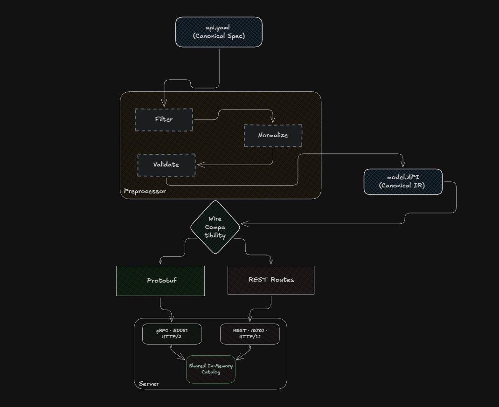

# Conduit

Conduit is a minimal build-time API contract pipeline written in Go. It is an educational prototype built after reading Uber's engineering article on [[Accelerating Search and Ingestion with High-Performance gRPC™ in OpenSearch™]](https://www.uber.com/in/en/blog/high-performance-grpc/?uclick_id=4ee71687-f07d-4bee-9e3b-f8786cdf84dc) to understand how canonical schema definitions, multi-target code generation, and wire-level backward compatibility mechanics work under the hood.



## How It Works

In microservice architectures, maintaining separate OpenAPI (REST) specs and Protobuf (gRPC) definitions inevitably leads to contract drift: an engineer renames a field in REST or changes a type in gRPC, and client SDKs silently break.

Conduit solves this by treating a single canonical YAML file as the source of truth, compiling it through an ordered pipeline into both targets while enforcing binary wire compatibility against baseline schemas:

1. **Parser**: Ingests the canonical YAML contract with strict schema validation, immediately rejecting typos and unrecognized keys instead of silently ignoring them.
2. **Preprocessor**:
   - **Filter**: Validates HTTP verbs (`GET`, `POST`, `PUT`, `PATCH`, `DELETE`) to guarantee unambiguous RPC-to-HTTP mapping.
   - **Normalize**: Standardizes message and field naming to PascalCase and deterministically assigns Protobuf field tags (`1..N`).
   - **Validate**: Verifies route structure, ensures URL path parameters (like `{id}`) have matching request fields, rejects multi-dimensional arrays unsupported by Protobuf, and aggregates all schema errors into a unified diagnostic report rather than stopping at the first mistake.
3. **IR (Intermediate Representation)**: An in-memory model (`model.API`) completely decoupled from target transport formats.
4. **Code Generators**:
   - Emits valid **Proto3** specifications adhering strictly to Buf standards (nested package directories and snake_case file names to satisfy linter rules).
   - Emits lightweight **REST Route Metadata JSON** mapping HTTP methods, paths, and parameter bindings for runtime dispatch.
5. **Compatibility Engine**: Compares the new specification's IR against a baseline specification. Rather than checking cosmetic field names, it evaluates **binary wire compatibility**:
   - Renaming a field with the same tag and type = `WARNING` (safe on the wire).
   - Changing a type, renumbering a tag, or deleting a field/method = `BREAKING` (rejects code generation).

### Engineering Insights & Tradeoffs

- **Wire Compatibility vs Semantic Changes**: On the Protobuf binary wire, field names do not exist—only tag numbers and wire types dictate decoding. If you rename `query` to `search_term` with tag `1` and type `string`, existing gRPC clients will decode it without issue. But if you change `int32` to `string` or reuse tag `1` for a different field, the decoder panics or corrupts data. Conduit's compatibility checker enforces this distinction.
- **Implicit Tag Ordering**: Right now, Conduit derives field tags based on their list order in the YAML file. In production, inserting a field at the top of a list would shift every subsequent tag down and trigger false breaking changes. To make this production-ready, the next step is supporting explicit tags (`tag: 1`) or maintaining an auto-generated `.conduit.lock` file that pins field names to immutable IDs.
- **Why Buf Compliance Matters**: Many custom proto generators emit files into the root directory, which immediately breaks modern Protobuf tooling. Conduit organizes generated output to match the package name (`catalog.v1` $\rightarrow$ `generated/catalog/v1/product_service.proto`), accompanied by a `buf.yaml` module definition, so `buf lint` passes with zero warnings out of the box.
- **Dual-Transport Parity Demo**: In `examples/server`, both transports run side-by-side: gRPC on port `:50051` and REST on port `:8080`. They share the exact same in-memory catalog and business logic, proving that one contract drives both protocols with identical outputs.

---

## Comparison to Industry Tools

| Feature | Conduit | grpc-gateway (Google) | Buf |
| :--- | :--- | :--- | :--- |
| **Source of Truth** | Canonical YAML | Protobuf (`.proto` + annotations) | Protobuf (`.proto`) |
| **Approach** | Spec-first $\to$ Multi-target | Proto-first $\to$ HTTP reverse proxy | Proto linter & BSR repository |
| **Compatibility Check** | In-engine wire diff against baseline YAML | None (runtime proxy) | Breaking change detection via git/BSR |
| **Footprint** | Single lightweight Go binary | Medium (requires protoc plugin pipeline) | Medium (CLI + toolchain) |

---

## Requirements

- Go 1.22+
- *(Optional)* `protoc`, `protoc-gen-go`, `protoc-gen-go-grpc` (if regenerating `.pb.go` stubs)
- *(Optional)* `buf` CLI

---

## Setup & Compilation

### 1. Compile Spec to Proto3 & REST Metadata

Run the Conduit compiler against the canonical spec:

```bash
go run ./cmd/conduit -spec api/api.yaml -out generated
```

Output:
```text
Successfully compiled to IR: service "ProductService" with 1 method(s)
Protobuf Generated in: generated/catalog/v1/product_service.proto
REST Generated in: generated/catalog/v1/product_service_routes.json
```

### 2. Enforce Wire Compatibility with Baseline

Conduit can guard your CI pipeline by comparing incoming changes against a baseline spec:

```bash
go run ./cmd/conduit -spec api/api.yaml -baseline examples/baseline.yaml
```

If a breaking change is introduced (e.g. changing `limit` from `int32` to `string`):

```text
--- Compatibility Report ---
BREAKING: ProductService.SearchProductsRequest
  field "limit" changed type "int32" -> "string"
----------------------------
Generation rejected: breaking changes detected against baseline.
exit status 2
```

---

## Usage: Dual-Transport Demo

Start the dual-transport server exposing both REST and gRPC over shared business logic:

```bash
go run ./examples/server
```

Output:
```text
gRPC server listening on port 50051...
REST server listening on port 8080...
```

### 1. Querying the REST Transport (Port 8080)

Query all products with `limit=3`:

```bash
curl -s "http://localhost:8080/v1/products?limit=3"
```

Response:
```json
{
  "products": [
    {"id": "p1", "name": "Mechanical Keyboard", "price": 129.99},
    {"id": "p2", "name": "Wireless Gaming Mouse", "price": 79.99},
    {"id": "p3", "name": "UltraWide 4K Monitor", "price": 499.99}
  ]
}
```

### 2. Querying the gRPC Transport (Port 50051)

Because port 50051 speaks binary HTTP/2 Protobuf frames, query it using the included Go client:

```bash
go run ./examples/client
```

Output:
```text
 Conduit Dual-Transport Client Demo 
[1] Calling REST API: GET http://localhost:8080/v1/products?query=keyboard
    HTTP Status: 200 OK
    REST Response JSON: {"products":[{"id":"p1","name":"Mechanical Keyboard","price":129.99}]}

[2] Calling gRPC RPC: ProductService.SearchProducts on localhost:50051
    gRPC Response Products: 1 item(s) returned
      - [p1] Mechanical Keyboard ($129.99)

Perfect Parity: REST and gRPC returned identical data over shared logic!
```

---

## Tests

Run all unit tests across the compiler, preprocessor, code generators, and compatibility engine:

```bash
go test -v ./...
```

